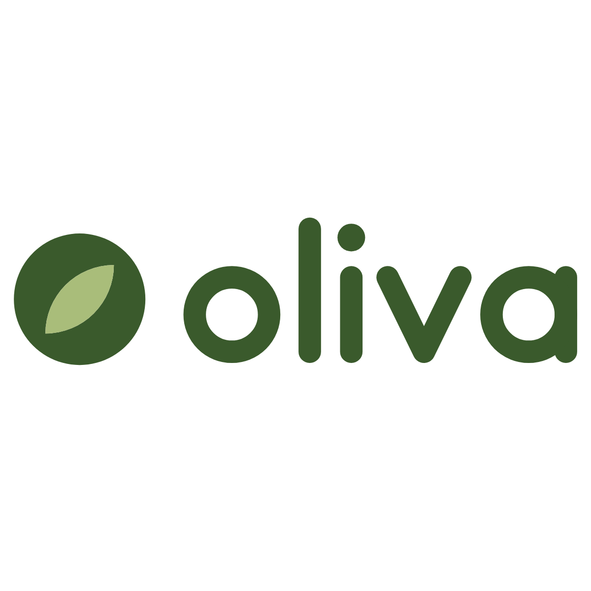

<p align="center">
  <picture>
    <source media="(prefers-color-scheme: dark)" srcset="design/logo/oliva/kit/export/png/oliva-horizontal-reversed.png">
    
  </picture>
</p>

<p align="center">
  <strong>Home-nursing care, shared between the nurse and the family.</strong><br>
  A Spanish-language mobile app for iOS, Android and web.
</p>

<p align="center">
  <a href="https://github.com/angelarroyod/vela/actions/workflows/ci.yml"></a>
  <a href="LICENSE"></a>
  
  
  
</p>

---

## Overview

**Oliva** is one app with two roles:

- **Nurse (enfermera)** records vital signs and medication, writes the shift handoff and keeps the care plan.
- **Family (familiar)** follows the patient's day and week, the history and the messages. Read-only, enforced by the database.

It is built with **Expo (React Native + TypeScript)**, **expo-router** and **Supabase** (Postgres, Row Level Security, realtime). The same code runs on iOS, Android and web, works offline, and the whole interface is in Spanish.

> **Naming.** The project was called **Vela**, then **Tend**, and is now **Oliva**. The old names remain in the repo name, the docs, the Expo slug/scheme and the `com.tend.app` bundle IDs.
>
> **Web companion.** [vela-web](https://github.com/angelarroyod/vela-web) (React + Vite) shares the same Supabase project but still uses the earlier Vela schema. See [Compatibility with vela-web](#compatibility-with-vela-web).

> [!IMPORTANT]
> The default vital-sign ranges and condition suggestions are typical placeholder values. **A clinician must review them before any release.**

## Contents

- [Features](#features)
- [Accessibility and design](#accessibility-and-design)
- [Getting started](#getting-started)
- [Architecture](#architecture)
- [Data model](#data-model)
- [Testing](#testing)
- [Project layout](#project-layout)
- [Roadmap](#roadmap)
- [Documentation](#documentation)
- [License](#license)

## Features

| Feature | What it does | Where |
|---------|--------------|-------|
| **Weekly family dashboard** | Today at the top (doses, vitals, *lo que debes saber*), the week below (dose strip, exceptions, 4-week trend charts) | Familia → Estado |
| **Dynamic vitals form** | Fields come from the patient's care plan; each value is checked against the patient's own ranges (normal / revisar / alerta, glucose by moment, pain 0–10) | Enfermera → Signos |
| **Daily history** | 7-day strip with a status dot per day, filters, and one timeline of doses, controls, notes and handoffs | Historial (both roles) |
| **Skip a dose with a reason** | *No se dio* requires a reason (and a note for *Otro motivo*), visible to everyone | Medicación |
| **Configurable reminders** | At the exact time or N minutes before, routed to whoever is on shift, with a shift-boundary warning | Medicación → Avisos |
| **Condition-based suggestions** | Adding a condition suggests which vitals to measure, how often and in which range | Plan de cuidados |

Also included:

- **"Lo siguiente"**, a priority hero for the nurse: fever → due dose → control → handoff.
- A **fever path** shared across the nurse and family screens.
- Structured **shift handoff**, medication schedules, per-nurse shift windows and quick replies in Mensajes.
- **Offline-first writes** with a pending banner and automatic resend on reconnect.
- 7-second toasts with **Deshacer** (undo), including while offline.
- Email/password and **Sign in with Apple**, family invite codes and in-app account deletion.

<details>
<summary><strong>All screens</strong></summary>

| Nurse | Family | Access and settings |
|-------|--------|---------------------|
| Inicio (Lo siguiente, paciente, en este turno) | Estado (hoy + esta semana) | Bienvenida (animated logo) |
| Signos (dynamic form) | Historial | Entrar · Crear cuenta |
| Historial | Mensajes | Elegir rol · Paciente · Código |
| Relevo de turno | Perfil del paciente | Configuración (tamaño del texto) |
| Perfil (turno, código de invitación) | Plan de cuidados (read-only) | Privacidad y aviso médico |
| Medicación → Aviso · Añadir medicamento | | |
| Plan de cuidados (editable) | | |

</details>

## Accessibility and design

The Oliva identity is documented in the [brand guide](design/logo/oliva/kit/GUIDE.md).

- **Light and dark** olive palettes, both checked for WCAG contrast in [`__tests__/theme.test.ts`](__tests__/theme.test.ts).
- [Atkinson Hyperlegible Next](https://fonts.google.com/specimen/Atkinson+Hyperlegible+Next) for all UI text.
- In-app **text size from 100 to 200 %** (Configuración → Tamaño del texto), applied to every string through one `<T>` component.
- Status is always **icon + word + colour**, never colour alone.
- Touch targets are **≥ 44 px**.
- Errors are written out in Spanish next to what failed and announced to screen readers.
- The animated logo respects **reduce motion**.
- iOS and Android use the system tab bar (Liquid Glass on iOS 26); web uses a floating glass bar.

## Getting started

### Prerequisites

- Node.js and npm
- A [Supabase](https://supabase.com) project
- [Expo Go](https://expo.dev/go) on a phone, or a browser for the web preview

### 1. Install

```bash
npm install
```

```bash
cp .env.example .env
```

Set `EXPO_PUBLIC_SUPABASE_URL` and `EXPO_PUBLIC_SUPABASE_ANON_KEY` in `.env`. Without them the UI still loads, but sign-in and data calls fail.

### 2. Set up the database

Run the files in [`supabase/migrations/`](supabase/migrations) **in order** in the Supabase SQL Editor:

| File | Purpose |
|------|---------|
| `0001_schema.sql` | Base schema |
| `0002_rls.sql` | Row Level Security policies |
| `0003_care_features.sql` | Care-feature tables; idempotent and purely additive |
| `0004_vital_readings_unique.sql` | One reading per vital per control |
| `0005_rls_perf.sql` | Faster policies (same access) and foreign-key indexes |

> [!NOTE]
> - Before running `0003` on a project with existing data, set `LEGACY_TZ` near the end of the file to your patients' time zone (default `Europe/Madrid`).
> - Re-run `0005` after re-running `0002`, `0003` or vela-web's migrations.

Account deletion uses the [`delete-account`](supabase/functions/delete-account) Edge Function; deploy it to your project for that feature to work.

### 3. Run

```bash
npm start
```

| Target | How |
|--------|-----|
| **Phone** | Scan the QR code with Expo Go (same Wi-Fi as the computer, or `npx expo start --tunnel`) |
| **Web** | `npm run web`, then open http://localhost:8081 |
| **iOS / Android** | `npm run ios` / `npm run android` |

### Scripts

| Command | Description |
|---------|-------------|
| `npm start` | Expo dev server |
| `npm run web` | Web preview on port 8081 |
| `npm test` | Jest test suite |
| `npm run typecheck` | TypeScript check (`tsc --noEmit`) |

## Architecture

```
Screen ──► mutate(builder, ...tables) ──► Supabase (PostgREST + RLS)
              │ offline                        │ realtime
              ▼                                ▼
         outbox (SecureStore) ──flush()──► useLiveList ──► pure care logic ──► Screen
```

- **Routing** ([`app/`](app)). `expo-router` with a session gate in `(app)/_layout.tsx`. The redirect decision is the pure, tested `routeForState` in [`src/features/auth/guard.ts`](src/features/auth/guard.ts). Nurse and family each have their own tab group.
- **Writes** ([`src/lib/db.ts`](src/lib/db.ts)). Every write goes through `mutate()`, which returns `null` or a Spanish error message and refreshes the affected live lists on the device.
- **Offline outbox.** While offline, `mutate()` stores the unexecuted request in a queue persisted with SecureStore and replays it in order on reconnect. Replays are idempotent: inserts carry a client-generated id, doses upsert on `(schedule_id, scheduled_for)`, and a unique-violation counts as sent.
- **Live data** ([`src/features/care/useLiveList.ts`](src/features/care/useLiveList.ts)). Realtime-subscribed lists per table and patient; queued offline writes are overlaid immediately, marked *Pendiente de enviar*.
- **Care logic** ([`src/features/care/`](src/features/care)). Pure, unit-tested TypeScript modules: `doses`, `vitals`, `vitalsForm`, `shifts`, `timeline`, `estado`, `nextUp` and `clock`. Screens stay thin.

### How it behaves

- **Doses are expanded on the device** from the schedules; only recorded doses are stored. A dose is *pending* until 60 minutes after its time and *sin registrar* after that (re-reminder at +30 min). Any nurse can record it later (*anotada más tarde*).
- **Reminders** go to whoever is on shift when they fire; a nurse without a fixed shift covers the gaps. Shifts can wrap overnight.
- **Severity** is *warn* outside the patient's normal range and *alert* outside the alert band. Blood pressure takes the worse of systolic and diastolic; glucose uses the range for its moment. A temperature above 37.5 °C opens the fever path until a doctor call is logged or a normal temperature is recorded.

## Data model

`0003_care_features.sql` adds, on top of the base schema:

| Table | Holds |
|-------|-------|
| `medication_schedules` | Medication, dose and purpose; `times time[]`; reminder (`exact` / `before` + minutes); start and end date; `suspended_at` (*Dejar de dar*) |
| `medication_doses` | One row per **recorded** dose: `given` or `skipped` (+ reason, note), who, when, `recorded_late` |
| `vital_readings` | One row per value; `control_id` groups one save; `severity` (ok / warn / alert) against the plan at save time |
| `patient_conditions` | The patient's conditions (8 kinds) |
| `vital_plans` | Per patient and vital: frequency, routine or not, normal range(s), alert band, source conditions |

It also adds `care_memberships.shift_start` / `shift_end`, extends the `care_team()` RPC with shift windows, and adds `set_my_shift` so a nurse can change only their own window.

### Security model

- New tables are **readable by the patient's members** and **writable only by nurse members**. Family is read-only by RLS, not by hidden buttons.
- `profiles` and `care_memberships` are readable only by their owner; team names come through the `care_team()` RPC.
- Author columns use `ON DELETE SET NULL`, so account deletion is never blocked.
- Every table is in the `supabase_realtime` publication.

### Compatibility with vela-web

vela-web still writes the legacy `vitals`, `medications` and `medication_plans` tables and the free-text `patients.conditions`. Migration `0003` keeps all of them and can run before or after vela-web's own migrations:

- Old `vitals` rows are copied into `vital_readings`.
- `medication_plans` become schedules with the same id, along with their administered doses; any other `medications` row becomes a one-day schedule.
- Re-running `0003` picks up rows written by vela-web since the last run.

Moving vela-web onto the new tables is planned separately.

## Testing

```bash
npm test
```

```bash
npm run typecheck
```

CI ([`.github/workflows/ci.yml`](.github/workflows/ci.yml)) runs both on every push and pull request. The care logic is covered by pure unit tests; screens are tested with React Native Testing Library, including accessibility checks in [`__tests__/a11y.test.tsx`](__tests__/a11y.test.tsx).

## Project layout

```
app/                    expo-router routes
  index.tsx             session-based entry redirect
  legal.tsx             privacy and medical notice (outside the session gate)
  (auth)/               welcome, login, signup, onboarding (role → patient | code)
  (app)/                session-gated
    nurse/(tabs)/       inicio, signos, historial, relevo, perfil
    nurse/              medicacion, aviso/[id], pauta-nueva
    family/(tabs)/      inicio (Estado), historial, mensajes, perfil
    plan.tsx            care plan (nurse edits, family reads)
    settings/           configuración
src/
  theme.ts              Oliva tokens: light and dark colour, type, radius, glass
  components/           T (scaled text), Button, Card, Status, Sheet, Toast, Logo, …
  features/care/        live hooks and pure care logic
  features/auth/        auth provider, membership, route guard, invites, Apple sign-in
  features/settings/    text size
  lib/                  Supabase client, env, mutate/outbox, Spanish error texts, prefs
supabase/
  migrations/           SQL migrations, applied in order
  functions/            delete-account Edge Function
design/logo/oliva/      brand kit, logo sources and exports
__tests__/              unit and screen tests
docs/superpowers/       earlier specs and plans (written under the Vela name)
```

## Roadmap

- [x] **M1 — Foundation:** screens, navigation, theme
- [x] **M2 — Backend and auth:** Supabase with RLS, email/password and Sign in with Apple, onboarding, family invites, account deletion
- [x] **M3 — Live data:** realtime sync between nurse and family
- [x] **M4 — Polish:** write-error handling, accessibility labels, privacy and medical-disclaimer screen
- [x] **M5 — Redesign:** accessible Oliva identity, the six care features, schedules, shifts, new schema, dark mode, offline outbox
- [ ] Push reminders and a server-side *sin registrar* job (needs an EAS dev build)
- [ ] Port vela-web to the new schema
- [ ] Release prep: EAS builds, TestFlight, store metadata, clinician review of default ranges

## Documentation

- [Brand guide](design/logo/oliva/kit/GUIDE.md)
- [Original design spec](docs/superpowers/specs/2026-06-26-vela-design.md)
- [Medication plans spec](docs/superpowers/specs/2026-10-01-vela-med-plans-design.md) (superseded by the current schema)
- Milestone plans: [M1](docs/superpowers/plans/2026-06-26-vela-m1-foundation.md) · [M2](docs/superpowers/plans/2026-06-26-vela-m2-backend-auth.md) · [M3](docs/superpowers/plans/2026-07-03-vela-m3-live-data.md) · [M4](docs/superpowers/plans/2026-07-03-vela-m4-polish.md)
- [CLAUDE.md](CLAUDE.md): conventions for contributors and coding agents

## License

[MIT](LICENSE) © 2026 Angel Arroyo
